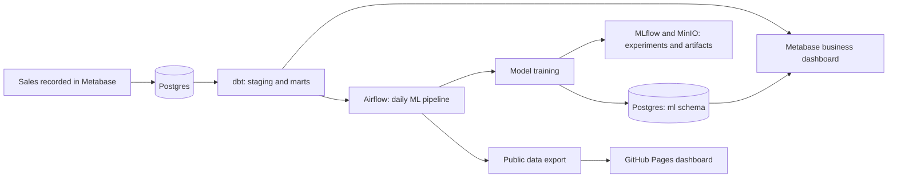

# Medrano Mercantile

An end-to-end data platform for a one-person reselling business, running on a self-hosted homelab. It covers everything from recording a sale to a tested warehouse, a business dashboard, tracked machine learning experiments and a public view.

**[Live public dashboard](https://manofmanana.github.io/medrano-mercantile/)** · **[dbt repo: medrano-mercantile-dbt](https://github.com/manofmanana/medrano-mercantile-dbt)**

## How it fits together

| Layer | Tool | Where |
| --- | --- | --- |
| Source of truth | Postgres | Private |
| Transformation and tests | dbt Core | [medrano-mercantile-dbt](https://github.com/manofmanana/medrano-mercantile-dbt) |
| Orchestration | Airflow | [`airflow/dags/`](airflow/dags) |
| Modeling | scikit-learn, lifelines | [`ml/train.py`](ml/train.py) |
| Experiment tracking | MLflow, MinIO | Private |
| Internal dashboard | Metabase | Private |
| Alerts | Grafana, on pipeline freshness in Postgres | Private |
| Weekly email | Airflow | [`airflow/dags/mercantile_weekly_report.py`](airflow/dags/mercantile_weekly_report.py) |
| Public read-only mirror | GitHub Pages | [`docs/`](docs/index.html), built by [`ml/publish.py`](ml/publish.py) |

## What the models found

Can a small shop's own data predict what an item will sell for, and how fast? Any model has to beat a simple baseline before it counts. A price model must beat its baseline with a 95% bootstrap interval that excludes zero. Results from 2026-11-12, on 88 sales:

| Question | Baseline | Best model | Verdict |
| --- | --- | --- | --- |
| Sale price from category and name | Overall median, $63.74 error | Random forest, $55.00 error | Passes, but weakly (see below) |
| Sale price given asking price | Asking × median ratio, $26.68 error | Ridge on asking price, $23.00 error | Failed |
| Time to sell | C-index 0.50 with shuffled labels | Cox model, C-index 0.65 | Passed |
| Days until it sells | Overall median, 29.7 days error | Weibull model, 35.3 days error | Failed |
| Day of the week it sells | Every day equal | Weekday pattern | Failed |

The price model's pass came right after a bulk sale of nine near-identical laptops, and it's weaker than the table suggests: on the most recent 25% of sales it does worse than a ridge model. [Twelve laptops and a leaky cross-validation](https://manofmanana.github.io/medrano-mercantile/notes/cv-leakage.html) explains what happened and what changed.

Items listed longer than any past sale get a Weibull estimate that is labeled as rough, because it extends beyond the observed data. Unsold items are treated as censored rather than dropped, which avoids overstating how fast things sell.

### Method

- Only fields known at listing time are used. `platform` is excluded because it's recorded after a sale.
- Prices are scored with 20 repeats of 5-fold cross-validation, plus a holdout of the most recent 25% of sales. Folds are grouped by product, so identical units ("Unit 2 of 5") never sit on both sides of a split.
- Time to sell uses Kaplan-Meier curves and a penalized Cox model, scored by cross-validated C-index against a permutation test.
- Asking prices can be edited after listing, which may make them look more predictive than they are.

## Operations

- Data-Lab runs `ml/` from a checkout of this repo that is reset to `main` before every run. The SSH wrapper Airflow calls ([`ml/deploy/mercantile-ml-remote`](ml/deploy/mercantile-ml-remote)) is installed by hand, so a push can change the code but not what Airflow's key may run.
- Each pipeline step records its outcome in `ml.pipeline_runs`. Grafana emails when dbt, training or publishing is stale or failed.
- A weekly email goes out every Sunday with last week's sales, the year's profit per hour, and the items to reprice under three rules (60+ days on hand, under $25, 7 days at one price).
- CI lints the Python and imports the ML code against the pinned [`ml/requirements.txt`](ml/requirements.txt).

## Privacy

The public dashboard is a read-only mirror of the private Metabase dashboard, including item names, sale prices and net profit. Consignor details, buyers, notes, SKUs, hours and editing tools stay private, and no credentials or internal addresses are in this repo. Model training reads through a read-only session and writes only to its own `ml` schema, using a role that can't change business data.

## Running it

`ml/train.py` and `ml/publish.py` read connection details from environment variables: `ML_PG_HOST`, `ML_PG_DB`, `ML_PG_USER`, `ML_PG_PASSWORD`, `ML_PG_WRITE_USER`, `ML_PG_WRITE_PASSWORD` and `MLFLOW_TRACKING_URI`. The warehouse tables they read are defined in the [dbt repo](https://github.com/manofmanana/medrano-mercantile-dbt). The weekly email reads an Airflow connection `mercantile_ro` (read-only Postgres), a connection `gmail_smtp` and a variable `weekly_report_to`.
