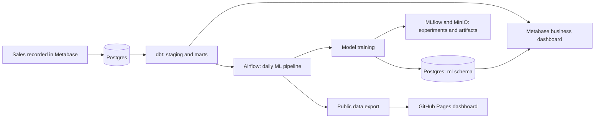

# Medrano Mercantile

An end-to-end data platform for a one-person reselling business, running on a self-hosted homelab. It covers everything from recording a sale to a tested warehouse, a business dashboard, tracked machine learning experiments and a public view.

**[Live public dashboard](https://manofmanana.github.io/medrano-mercantile/)** · **[dbt repo: medrano-mercantile-dbt](https://github.com/manofmanana/medrano-mercantile-dbt)**

## How it fits together

| Layer | Tool | Where |
| --- | --- | --- |
| Source of truth | Postgres | Private |
| Transformation and tests | dbt Core, 57 tests | [medrano-mercantile-dbt](https://github.com/manofmanana/medrano-mercantile-dbt) |
| Orchestration | Airflow | [`airflow/dags/mercantile_ml.py`](airflow/dags/mercantile_ml.py) |
| Modeling | scikit-learn, lifelines | [`ml/train.py`](ml/train.py) |
| Experiment tracking | MLflow, MinIO | Private |
| Internal dashboard | Metabase | Private |
| Public read-only mirror | GitHub Pages | [`docs/`](docs/index.html), built by [`ml/publish.py`](ml/publish.py) |

## What the models found

Can a small shop's own data predict what an item will sell for, and how fast? Any model has to beat a simple baseline before it counts. A price model must beat its baseline with a 95% bootstrap interval that excludes zero. Results from 2026-11-03, on 72 sales and 98 items with listing dates:

| Question | Baseline | Best model | Verdict |
| --- | --- | --- | --- |
| Sale price from category and name | Overall median, $54.72 error | Ridge on category, $54.96 error | Failed |
| Sale price given asking price | Asking price, $16.29 error | Ridge on asking price, $20.97 error | Failed |
| Time to sell | C-index 0.51 with shuffled labels | Cox model, C-index 0.61 | Weak signal, p = 0.0495 |

Items listed longer than any past sale get a Weibull estimate that is labeled as rough, because it extends beyond the observed data. The honest conclusion is that this dataset can't support price prediction yet, and the asking price is the best predictor available. The failed models aren't registered or shown as predictions. The time-to-sell result is useful for rough ranking only, and it could weaken with more data.

Half of items sell within about 54 days. Unsold items are treated as censored rather than dropped, which avoids overstating how fast things sell.

### Method

- Only fields known at listing time are used. `platform` is excluded because it's recorded after a sale.
- Prices are scored with 20 repeats of 5-fold cross-validation, plus a holdout of the most recent 25% of sales.
- Time to sell uses Kaplan-Meier curves and a penalized Cox model, scored by cross-validated C-index against a permutation test.
- Asking prices can be edited after listing, which may make them look more predictive than they are.

## Privacy

The public dashboard is a read-only mirror of the private Metabase dashboard, including item names, sale prices and net profit. Consignor details, buyers, notes, SKUs and editing tools stay private, and no credentials or internal addresses are in this repo. Model training reads through a read-only session and writes only to its own `ml` schema, using a role that can't change business data.

## Running it

`ml/train.py` and `ml/publish.py` read connection details from environment variables: `ML_PG_HOST`, `ML_PG_DB`, `ML_PG_USER`, `ML_PG_PASSWORD`, `ML_PG_WRITE_USER`, `ML_PG_WRITE_PASSWORD` and `MLFLOW_TRACKING_URI`. The warehouse tables they read are defined in the [dbt repo](https://github.com/manofmanana/medrano-mercantile-dbt).
